  

📍 Mendoza, Argentina · 🟢 Abierto a nuevas oportunidades

---

## Sobre mí

- Estudiante de Ingeniería en Informática en la **Universidad de Mendoza**.
- Armo aplicaciones de punta a punta: la app móvil en **Flutter**, la API en **FastAPI** o **Spring Boot** y la base de datos que las sostiene.
- Me interesa la IA aplicada a problemas reales, sobre todo visión por computadora: en mis proyectos el backend procesa video e imágenes con **TensorFlow**, **YOLOv8** y **OpenCV**.
- Acostumbrado a trabajar en equipo con Git, ramas y pull requests.

## Tecnologías

   
  

  
  
  
  
  

---

## Proyectos destacados

<table>
  <tr>
    <td align="center" width="33%" valign="top">
      
       
      App para practicar oratoria. Se graba un video desde el celular, el backend sigue el rostro y clasifica la emoción en cada momento, y la app muestra el resultado en un gráfico de radar. Con cuentas de usuario y galería propia.
        
      <code>Flutter</code> <code>FastAPI</code> <code>TensorFlow</code> <code>OpenCV</code>
        
      🔗 <a href="https://github.com/Ezeg914/Orator-IA"><b>Repo</b></a>
    </td>
    <td align="center" width="33%" valign="top">
      
       
      App que evalúa soldaduras a partir de una foto. Un modelo YOLOv8 detecta cada cordón y lo clasifica como buena soldadura, mala soldadura o defecto, y cada caño guarda su historial de imágenes analizadas.
        
      <code>Flutter</code> <code>FastAPI</code> <code>YOLOv8</code>
        
      🔗 <a href="https://github.com/Ezeg914/Welding-IA"><b>Repo</b></a>
    </td>
    <td align="center" width="33%" valign="top">
      
       
      App móvil y API REST para buscar y reservar pasajes de colectivos de larga distancia, con autenticación por JWT. Proyecto en equipo de tres personas.
        
      <code>React Native</code> <code>Spring Boot</code> <code>MySQL</code>
        
      🔗 <a href="https://github.com/Ezeg914/GoTicket"><b>Repo</b></a>
    </td>
  </tr>
</table>

---

## Colaboraciones

- [**ticketek_2024**](https://github.com/j0k3rD/ticketek_2024) · Python
- [**Ing.software**](https://github.com/bruno212121/Ing.software) · proyecto de Ingeniería de Software, Universidad de Mendoza

## Formación

**Ingeniería en Informática** · Universidad de Mendoza
